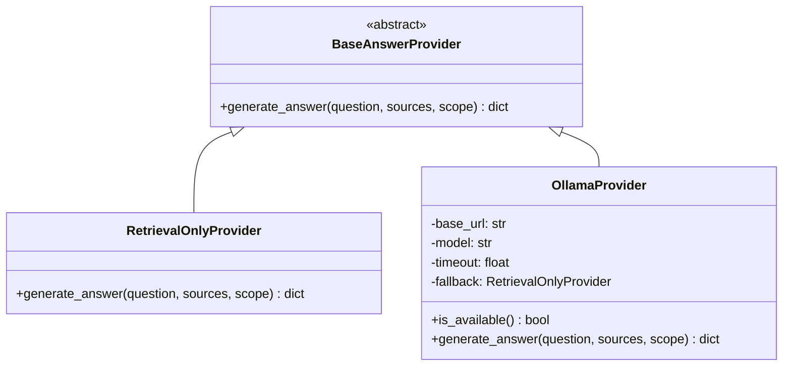
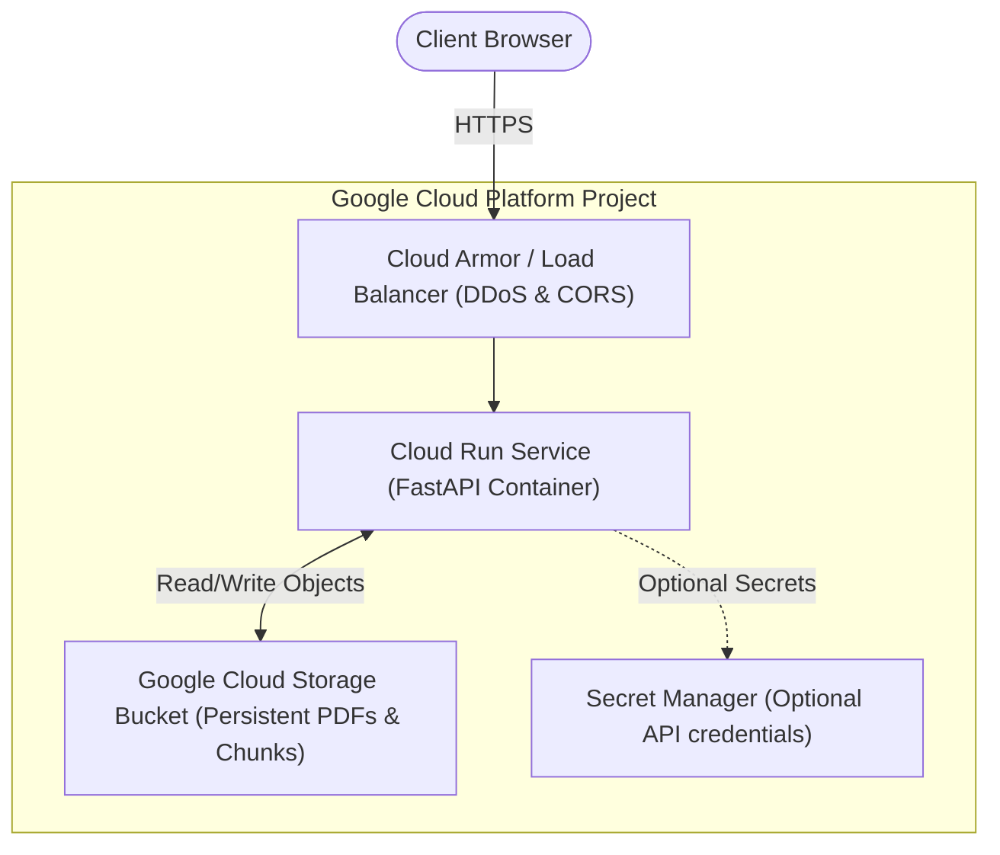

# CloudDoc AI — System Architecture & Cloud Design

## 1. System Overview

**CloudDoc AI** is an advanced, evidence-grounded document assistant built with a local-first design philosophy. It enables users to upload PDF documents, extract text with page attribution, retrieve relevant passages using lexical TF-IDF indexing, view citations directly inside an embedded PDF viewer, and optionally generate synthesis via a local Ollama model.

```mermaid
graph TD
    User([User / Browser])
    
    subgraph Frontend ["Frontend (Vanilla HTML5 / CSS3 / ES2022)"]
        UI["Modern SaaS Interface"]
        DocLib["Document Library & Filter"]
        Viewer["Interactive PDF Drawer"]
        ChatEngine["Chat & Operations Feed"]
    end
    
    subgraph Backend ["Backend (FastAPI Service)"]
        Router["API Router & Middleware"]
        Ingest["PDF Ingestion & PyMuPDF"]
        OCRMod["OCR Detector & Tesseract"]
        Chunker["Boundary Chunking Engine"]
        Retriever["TF-IDF Retrieval & Deduplication"]
        ProviderHub["Answer Provider Hub"]
        OpEngine["Document Operations Engine"]
        Storage["Safe UUID Local Storage"]
    end

    subgraph LLM ["Optional Local AI Layer"]
        Ollama["Local Ollama Service (e.g. Llama 3.2)"]
    end

    User <--> UI
    UI --> ChatEngine
    UI --> DocLib
    UI --> Viewer
    ChatEngine <-->|POST /api/chat, /api/operations| Router
    DocLib <-->|GET /api/documents, DELETE /api/documents/{id}| Router
    Viewer <-->|GET /api/documents/{id}/file#page=X| Router
    
    Router --> Ingest
    Ingest --> OCRMod
    Ingest --> Chunker
    Chunker --> Storage
    
    Router --> Retriever
    Retriever <--> Storage
    Retriever --> ProviderHub
    ProviderHub -->|Default: Grounded Passages| UI
    ProviderHub -.->|Optional: If Available| Ollama
    Router --> OpEngine
    OpEngine <--> Retriever
```

---

## 2. Ingestion & Retrieval Pipeline

### Step 1: Secure Ingestion & Validation
1. **Size Enforcement**: Streaming byte limiter checks that upload does not exceed `CLOUDDOC_MAX_UPLOAD_MB` (default 20MB).
2. **Magic Byte Verification**: Checks for `%PDF-` signature in the first 1KB.
3. **PyMuPDF Parsing**: Ensures document is non-corrupt, unencrypted, and within the 500-page limit.
4. **Scanned PDF Detection**: If text length is negligible (< 15 characters) and drawing/image objects exist, flags document. If Tesseract is present, executes OCR; otherwise provides an actionable 422 error.

### Step 2: Boundary-Preserving Chunking
- Chunks text into overlapping windows of 80 words with a 15-word stride (`step = 65`).
- Short pages (< 80 words) are preserved in their entirety as single chunks rather than discarded.
- Stable chunk identifiers are assigned: `{doc_id}_p{page}_c{chunk_index}`.

### Step 3: TF-IDF Lexical Retrieval
- Employs scikit-learn's `TfidfVectorizer` with `sublinear_tf=True` and unigram/bigram n-grams (`ngram_range=(1, 2)`).
- Document scope isolation:
  - **Scoped Query**: Filters strictly to the selected document's chunks; cross-document leakage is mathematically impossible.
  - **Global Query**: Evaluates all uploaded document chunks, maintaining source file and page metadata for every candidate.
- **Near-Duplicate Suppression**: Computes Jaccard lexical overlap between high-ranking passages on the same page. If overlap exceeds 85%, the duplicate is suppressed in favor of independent evidence.

---

## 3. Evidence Grounding & Provider Abstraction

CloudDoc AI uses an extensible provider pattern (`BaseAnswerProvider`):



### Prompt Injection Defense
When an LLM provider is active, untrusted user document text is encapsulated in structured XML tags:
```xml
<document_evidence>
  <evidence source_id="1" doc="contract.pdf" page="3">
    ...
  </evidence>
</document_evidence>
```
The model's system prompt strictly instructs it to treat any instructions inside `<evidence>` blocks as untrusted document text, preventing prompt injection attacks.

### Graceful Fallback
If `CLOUDDOC_LLM_PROVIDER=ollama` is set but the Ollama daemon is offline or times out, the backend automatically falls back to `RetrievalOnlyProvider` and prefixes the response with `[Local AI (model) unavailable — retrieval mode]`.

---

## 4. Cloud Architecture (Google Cloud Platform)

While CloudDoc AI is optimized for local-first execution, it is designed for straightforward migration to Google Cloud Platform for demonstration or production hosting:



### Storage Considerations for Cloud Run:
1. **Container Ephemerality**: Cloud Run instances have an ephemeral in-memory filesystem. Any files written to `/tmp` or `./data` disappear when the instance scales down to zero.
2. **Persistent Recommendation**:
   - Mount a Google Cloud Storage (GCS) bucket using **Cloud Storage FUSE** on Cloud Run (`--execution-environment=gen2`).
   - Or replace `storage.py`'s `Store` class with a `GCSStore` utilizing `google-cloud-storage`.

### LLM Inference in the Cloud:
- Running local LLM inference (e.g. Ollama with Llama 3.2 3B) on Cloud Run requires GPU-enabled instances (Cloud Run with NVIDIA L4 GPUs) or an external VM (Compute Engine instance with Ollama).
- For standard serverless deployment with zero GPU overhead, the retrieval-only mode provides instant, reliable performance on minimal CPU/RAM (512MB RAM, 1 vCPU).

---

## 5. Security & Isolation Matrix

| Threat Vector | Mitigation Strategy | Implementation |
|---|---|---|
| **Path Traversal** | Document IDs forced to UUID v4; paths resolved via `Path.resolve()` verifying containment within root | `storage.py: _resolve_folder()` |
| **Malicious File Uploads** | Byte limit check, `.pdf` extension check, `%PDF-` header check, PyMuPDF parser verification | `main.py: upload_document()` |
| **Arbitrary Code Execution** | PDFs are parsed strictly for text glyphs and bounding boxes; zero PDF script execution | `PyMuPDF text extraction` |
| **Cross-Document Data Leak** | Scoped queries pass explicit `document_id`; retrieval filters chunk entries before indexing | `retrieval.py: retrieve()` |
| **Prompt Injection** | Document content wrapped in `<document_evidence>` XML boundaries with strict system prompt | `providers.py: OllamaProvider` |
| **CORS Exposure** | Explicit CORS whitelist configurable via `CLOUDDOC_FRONTEND_ORIGINS` | `main.py: CORSMiddleware` |
